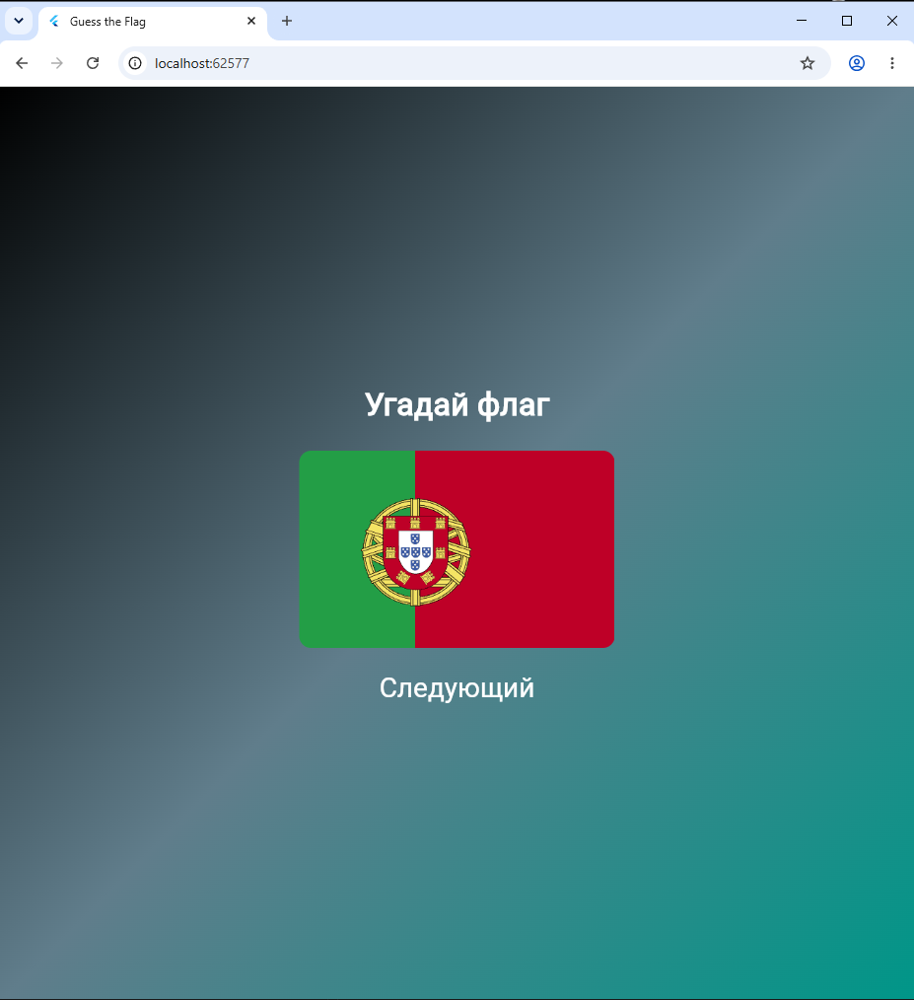

# Лабораторная работа №6. Flutter: самостоятельное приложение

## Описание

Приложение **«Угадай флаг»** показывает изображение флага одной из трёх стран. При нажатии кнопки «Следующий» флаг
меняется случайным образом — используется генератор случайных чисел из
`dart:math`.
## Автор
 - **Корначев Кирилл**
 - **Группа: ИСП-243**
 - **Дата сдачи:**
## Стек и версии
 - **Flutter** - `3.47.4`
 - **Dart** - `3.13.3`
 - **Платформа Web `Chrome`**
 - **IDE: `VS Code`**
## Скриншот работающего приложения

## Структура приложения
`my_app_kornachev`
- `assets/`
- `images/`
- `kingdom.png` - **флаг Великобритании**
- `irland.png` - **флаг Ирландии**
- `Portugal.png` - **флаг Португалии**
- `lib/`
- `main.dart` - **точка входа, MaterialApp и Scaffold**
- `widgets/`
- `gradient_container.dart` - **StatelessWidget с градиентным фоном**
- `flag_image.dart` - **StatelessWidget с картинкой флага**
- `flag_quiz.dart` - **StatefulWidget с логикой, setState и Random**
## Как запустить
```
git clone <ссылка на репозиторий>
cd <папка проекта>
flutter pub get
flutter run -d chrome
```
## Что изучили
- Научились делить UI на отдельные виджет-классы и раскладывать их по файлам.
- Освоили передачу данных в виджет через параметры конструктора.
- Разобрались, как работает `StatefulWidget` и `setState()` для обновления экрана.
- Подключили свои картинки через `pubspec.yaml` (секция `assets`).
- Использовали `Random` из `dart:math` для случайного выбора.
